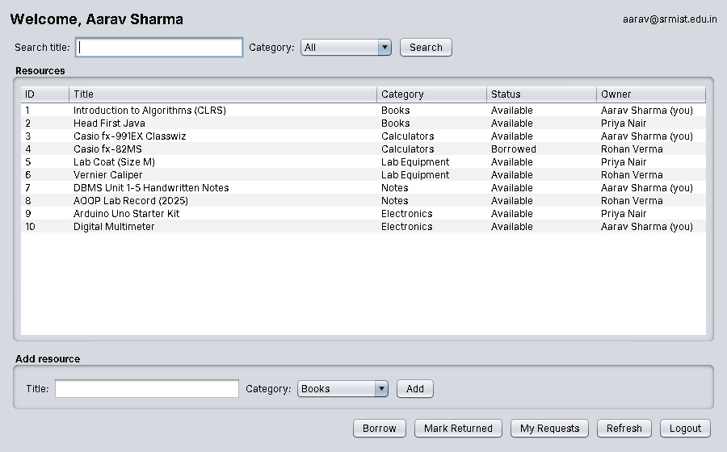
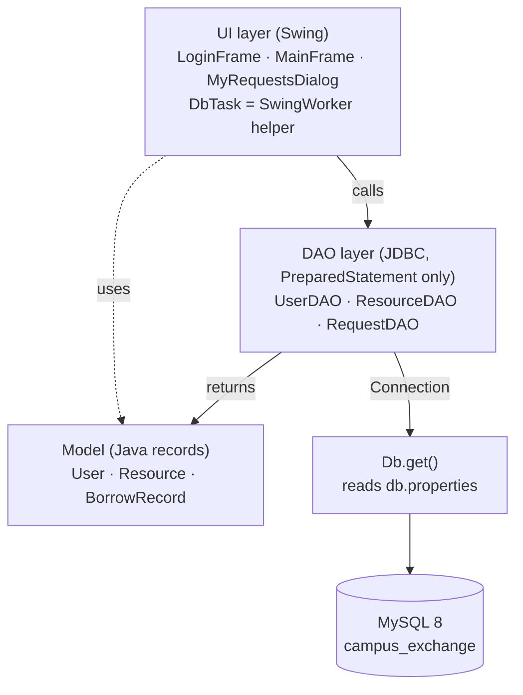

# Campus Resource Exchange

A Java desktop application where students **lend** things they own (books, calculators, lab
equipment, notes, electronics) and **borrow** items listed by others.

Built with **Java Swing + JDBC + MySQL 8** as a college project for
**SRM 21CSC206P – Advanced Object-Oriented Programming**.



---

## Features

- **Log in by email** or **register** with name + email (duplicate emails are rejected).
- **Browse** every listed resource in a table: ID, Title, Category, Status, Owner.
- **Search** by title keyword (case-insensitive) and **filter** by category (`All` + categories in the DB).
- **Add a resource** you want to lend (Books, Calculators, Lab Equipment, Notes, Electronics, Other).
- **Borrow** an available item. This runs as a single database **transaction**, so two students
  can't borrow the same item at once. You can't borrow your own items.
- **Mark Returned**: only the owner can do this, and only while the item is `Borrowed`.
- **My Requests** shows your full borrow history.
- The UI stays responsive because every database call runs in a `SwingWorker`. Every
  `SQLException` is shown in a dialog.

## Architecture

The app is split into layers. The UI never writes SQL: it calls DAO methods, and the DAOs get
their connections from `Db`.



Plain-text version:

```
+--------------------------------------------------------------+
|  UI (Swing): LoginFrame, MainFrame, MyRequestsDialog          |
|  DbTask -> SwingWorker: DB work off the EDT, errors in dialogs|
+-------------------------------+------------------------------+
                                | method calls (no SQL)
+-------------------------------v------------------------------+
|  DAO: UserDAO, ResourceDAO, RequestDAO                        |
|  PreparedStatement + try-with-resources, borrow() transaction |
+-------------------------------+------------------------------+
                                | Db.get()
+-------------------------------v------------------------------+
|  MySQL 8: users --< resources --< requests >-- users          |
+--------------------------------------------------------------+
```

### Database design

| Table       | Columns                                                                                  |
|-------------|------------------------------------------------------------------------------------------|
| `users`     | `user_id` PK, `name`, `email` UNIQUE                                                     |
| `resources` | `resource_id` PK, `title`, `category`, `status` (default `Available`), `owner_id` FK → users |
| `requests`  | `request_id` PK, `resource_id` FK → resources, `borrower_id` FK → users, `request_date`  |

### How borrowing works (transaction)

```
setAutoCommit(false)
  SELECT owner_id ...                         -> reject if borrower is the owner
  UPDATE resources SET status='Borrowed'
   WHERE resource_id=? AND status='Available' -> 0 rows? "Resource is not available"
  INSERT INTO requests (..., CURDATE())
commit()            -- any error: rollback()
```

The `AND status='Available'` condition makes the check and the update one atomic step. If two
students click Borrow at the same moment, only one UPDATE changes a row, and the other student
gets an error with no request row created.

## Prerequisites

- **JDK 17+**
- **Maven 3.8+** (or the Maven bundled with your IDE)
- **MySQL 8** server and **MySQL Workbench** (or the `mysql` command-line client)

## Setup

1. **Create the database.** In MySQL Workbench, open and run, in this order:
   1. `sql/schema.sql`: creates the `campus_exchange` database and its tables
   2. `sql/sample_data.sql`: adds 3 users and 10 resources

   Command-line alternative:
   ```bash
   mysql -u root -p < sql/schema.sql
   ```
   ```bash
   mysql -u root -p < sql/sample_data.sql
   ```

2. **Configure the connection.** Copy the example file and set your MySQL password:
   ```bash
   cp db.properties.example db.properties
   ```
   ```properties
   db.url=jdbc:mysql://localhost:3306/campus_exchange
   db.user=root
   db.password=your_mysql_password
   ```
   `db.properties` must be in the **working directory** (the project root when running from an
   IDE or the terminal). It is git-ignored, so your password stays on your machine. If the file is
   missing, the app tries `root` with an empty password.

3. **Log in** with a sample account, for example `aarav@srmist.edu.in`, `priya@srmist.edu.in` or
   `rohan@srmist.edu.in`, or register a new one.

## Running

### From an IDE

| IDE | Steps |
|-----|-------|
| **IntelliJ IDEA** | *File → Open* → select the project folder (it is detected as a Maven project). Open `src/main/java/com/campusexchange/Main.java` → click ▶ next to `main`. Make sure the run configuration's *Working directory* is the project root. |
| **NetBeans** | *File → Open Project* → select the folder (Maven projects open natively). Right-click the project → *Properties → Run* → Main Class `com.campusexchange.Main` → *Run*. |
| **Eclipse** | *File → Import → Maven → Existing Maven Projects* → select the folder. Right-click `Main.java` → *Run As → Java Application*. |

### From the terminal

```bash
mvn clean package
```
```bash
java -jar target/campus-resource-exchange-1.0.0-jar-with-dependencies.jar
```

`mvn package` also runs the unit tests. Run it from the folder that contains `db.properties`.

### Tests

```bash
mvn test
```

The DAO tests use an in-memory **H2** database in MySQL mode, so they need **no MySQL server**.
Each test loads the real `sql/schema.sql`, skipping the `CREATE DATABASE`/`USE` lines. They
cover:

- register + duplicate email rejected
- add + search (keyword, category, `categories()`)
- borrow updates the status and records a request
- borrowing an already-borrowed item fails and leaves **no** new request row (rollback)
- you can't borrow your own item
- only the owner can mark an item returned, and only while it is borrowed
- SQL-injection strings in search return nothing extra

## Project structure

```
campus-resource-exchange/
├── pom.xml                      Maven build (mysql-connector-j, JUnit 5, H2 for tests, fat jar)
├── db.properties.example        Copy to db.properties and set your password
├── sql/
│   ├── schema.sql               Database + tables
│   └── sample_data.sql          3 users, 10 resources, 1 borrow
├── docs/main-window.png         Screenshot
└── src/
    ├── main/java/com/campusexchange/
    │   ├── Main.java            Entry point (Nimbus look and feel, starts on the EDT)
    │   ├── db/Db.java           Connection factory (reads db.properties)
    │   ├── model/               User, Resource, BorrowRecord (records)
    │   ├── dao/                 UserDAO, ResourceDAO, RequestDAO
    │   └── ui/                  LoginFrame, MainFrame, MyRequestsDialog, DbTask
    └── test/java/com/campusexchange/dao/
        └── DaoTest.java         JUnit 5 + H2 DAO tests
```

## OOP and JDBC concepts demonstrated

- **Encapsulation and layering**: UI → DAO → DB, each layer with one job.
- **Immutable models** using Java `record`s.
- **Inheritance**: frames and dialogs extend `JFrame`/`JDialog`. Anonymous subclasses of
  `DefaultTableModel` make cells read-only.
- **Functional interfaces and lambdas**: `DbTask.Work<T>` and event listeners.
- **Generics**: `DbTask.run(...)` works with any result type.
- **Exception handling**: `SQLException` is shown in the UI, and transactions use commit/rollback.
- **JDBC best practices**: `PreparedStatement` everywhere (no SQL injection), try-with-resources
  for every `Connection`/`Statement`/`ResultSet`, and generated keys.
- **Concurrency**: `SwingWorker` keeps the Event Dispatch Thread free.

## Future work

- **Password hashing**: real passwords hashed with BCrypt or Argon2 instead of email-only login.
- **Owner approval of requests**: a `Pending → Approved/Rejected` workflow before an item is lent.
- **Connection pooling**: HikariCP instead of opening a new connection for each call.
- Due dates and overdue reminders, return history (`returned_date` column), item photos, and ratings.
